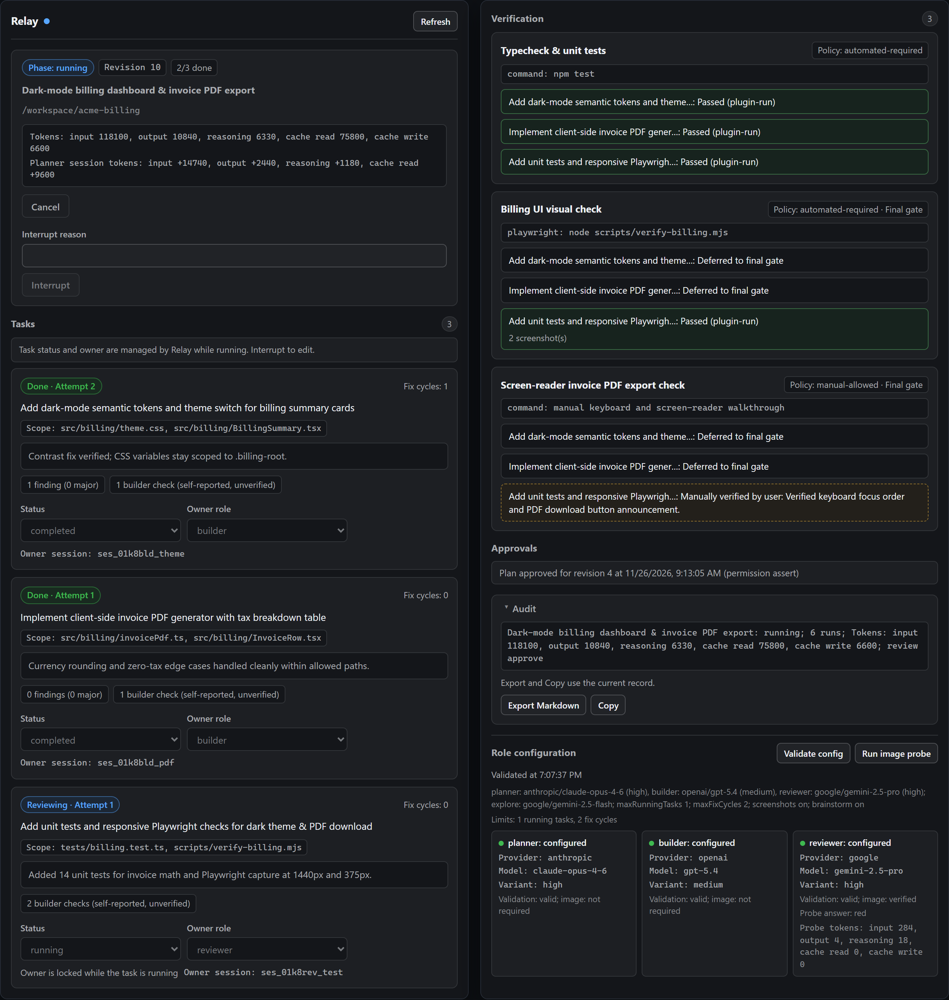
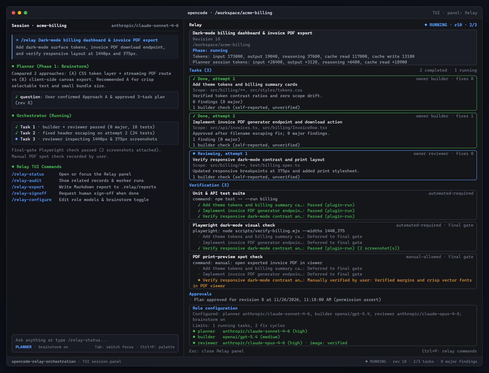

# opencode-relay-orchestration

**Multi-model brainstorm, plan, build, verify, and review orchestration plugin for OpenCode**: coordinates dedicated `planner`, `builder`, `reviewer`, and read-only `explorer` models with brainstorm-first alignment, revision-bound human plan approvals, structural file-scope gates, automated command and Playwright verification, and redacted Markdown audit reports in both the TUI and OpenCode Desktop.

| OpenCode Desktop | OpenCode TUI |
| :---: | :---: |
| [](./assets/screenshot.png) | [](./assets/screenshot-tui.png) |
| [View full size](./assets/screenshot.png) | [View full size](./assets/screenshot-tui.png) |

*Note: Previews were rendered in headless Chromium via Playwright from the plugin's actual Desktop (`dist/gui-experimental.cjs`) and TUI (`src/tui.ts`) UI code using synthetic fixture data and a simulated host frame, rather than captured from a live OpenCode window or terminal.*

## OpenCode Desktop Support

**Available in OpenCode Desktop as well as the TUI.** Inspect active Relay records, tasks, verification checks, evidence, approvals, role validation, and redacted audit summaries in a persistent `Relay` side panel (`opencode-relay-orchestration:relay-status`), or trigger `/relay-status` from the slash menu and command palette without spending a model turn.

One global OpenCode V2 plugin entry loads the server hooks, agent tools, TUI panel, and Desktop side panel together. Installing the plugin does not start tasks, prompt models, or create records until you invoke `/relay`, `/relay-configure`, or create a record explicitly; see [Installation](#installation) for setup.

## Background

Multi-model coding workflows often start as custom slash prompts or `AGENTS.md` checklists asking one chat session to plan, spawn subagents, run tests, and review its own work. In daily use, that prompt-only approach hits three recurring limitations:

1. **Weak separation of duties**: Prompt rules alone cannot stop a builder from editing out-of-scope files, self-approving a plan, or skipping Playwright screenshots when context grows long.
2. **Unverified claims and lost state**: Verification output, fix-cycle counters, screenshot hashes, and token totals live only as transient chat text that disappears or drifts across compactions.
3. **Manual model juggling**: Switching between a planning model, a fast builder, a read-only explorer, and a vision-capable reviewer requires repetitive manual configuration and offers no structured audit trail.

`opencode-relay-orchestration` moves that workflow into OpenCode's plugin runtime:

1. **Revision-bound human gates (`relay.approve`, `relay.signoff`, `relay.verify`, `relay.configure`)**: Plans, manual verifications, configuration saves, and final sign-offs are enforced through OpenCode's native permission hooks pinned to exact record revisions.
2. **Isolated role workers & structural enforcement**: Builders run in isolated child sessions with optional `allowedPaths` file-scope guards in `ctx.permission.hook('evaluate')`, automated checks run in the plugin runtime (`command` and `playwright` adapters), and read-only reviewers inspect every attached screenshot by exact filename.
3. **Zero-token TUI & Desktop inspection**: Status, checks, approvals, role validation, audit summaries, and redacted Markdown report exports run over typed `RelayRpc` calls without an LLM turn.

## Features

| Feature | Details |
| :--- | :--- |
| Role-based multi-model routing | Assign distinct models and optional variants to `planner`, `builder`, `reviewer` (image-input required), and optional read-only `explorer` |
| Interactive setup (`/relay-configure`) | Queries enabled OpenCode models and image capabilities, asks all 10 setup questions in one batched `question` prompt (4 roles + 6 settings), and saves to plugin storage (`relay/config`) behind a `relay.configure` permission gate |
| Brainstorm-first planning (`/relay <task>`) | Enabled by default (`brainstormFirst: true`): forces Phase 1 read-only exploration, 2-3 approaches with tradeoffs/risks/non-goals, and `question` alignment before any `relay_plan_add` or `relay_plan_submit` calls (with a fast-track skip option or `relay_plan_cancel`) |
| Revision-bound plan approvals | Plans (`tasks`, `allowedPaths`, `checks`) are approved at a specific `planRevision` through OpenCode's native `relay.approve` permission prompt and can be withdrawn cleanly while pending |
| Automated build, verify, review, fix cycles | Isolated builder sessions execute tasks, plugin-run verification checks execute `command` or `playwright` suites, and read-only reviewer sessions report `approve` or `changes` up to `maxFixCycles` |
| Per-task & final-gate checks | Checks default to `scope: "task"` (run after each task build) or set `scope: "final"` to defer until the final task review; sign-off enforces freshness against every task's latest build |
| Structural builder file-scope gate (`allowedPaths`) | Up to 20 repo-relative paths or globs per task structurally deny `edit`, `write`, `patch`, `apply_patch`, and `multiedit` calls outside scope via `ctx.permission.hook('evaluate')` |
| Screenshot hashing & attachment caps | Playwright checks collect fresh PNGs under `screenshotDir` (default `.screenshots`), SHA-256 hash them, fail loudly above 8 files or 12 MiB per check, and escalate reviews above 12 files or 16 MiB combined |
| Redacted Audit & Markdown export | Inspect related records, worker token totals, planner session token delta, evidence, and reviews in TUI (`/relay-audit`, `/relay-export`) or Desktop (`Export Markdown` / `Copy Markdown`), with local path redaction |
| OpenCode TUI & Desktop GUI parity | Native OpenTUI panel (`src/tui.ts`) and Desktop side panel (`src/gui.tsx`, bundled to `dist/gui-experimental.cjs`) backed by `RelayRpc` (`src/rpc.ts`) |

## Installation

### Option 1: OpenCode Plugin CLI (Recommended)

Install with OpenCode's native plugin CLI. OpenCode downloads the package from npm (or GitHub) into its own cache automatically and adds one entry to `~/.config/opencode/opencode.jsonc` that loads the server hooks, planner/worker tools, TUI panel, and Desktop side panel together:

```sh
opencode plugin add @nandoblanco/opencode-relay-orchestration
# Auto-update on startup and every 24 hours:
opencode plugin add @nandoblanco/opencode-relay-orchestration@latest
# Or install directly from GitHub:
opencode plugin add github:nandoblanco/opencode-relay-orchestration
```

### Option 2: Manual Configuration

Add `@nandoblanco/opencode-relay-orchestration` to `"plugins"` in the global `~/.config/opencode/opencode.jsonc` (or project `./opencode.jsonc` / `./.opencode/opencode.jsonc`). Static `options` act as defaults and can be overridden at any time by `/relay-configure` in plugin storage (`relay/config`):

```jsonc
{
	"plugins": [
		{
			"package": "@nandoblanco/opencode-relay-orchestration",
			"options": {
				"limits": {
					"maxRunningTasks": 1,
					"maxFixCycles": 2
				},
				"widths": [1280, 390],
				"autoStart": true,
				"explorer": true,
				"brainstormFirst": true,
				"enableProbe": false
			}
		}
	]
}
```

### Option 3: From a Local Directory

Use Node.js `^22.15.0 || >=23.5.0`. Clone this repository, install dependencies, and run `npm run build` to build `dist/gui-experimental.cjs` for OpenCode Desktop, then reference the directory in `opencode.jsonc`:

```sh
npm ci
npm run build
```

```json
{
	"plugins": ["file:///path/to/opencode-relay-orchestration"]
}
```

## Usage

### Interactive Setup (`/relay-configure`)

Relay ships with no hardcoded default models. Configure at least `builder` and `reviewer` before running `/relay` (either with `/relay-configure` or static `options.roles` in `opencode.jsonc`). Leaving `planner` unset runs planning on your current session model; leaving `explorer` unset omits `relay_explore`.

Run `/relay-configure` inside an OpenCode session. Relay queries your currently enabled models and presents one batched `question` prompt containing 10 questions (4 role assignments + 6 settings):

1. **Roles**: `planner`, `builder`, `reviewer` (image-capable models only), and `explorer`, each offering top 3 recommended candidates plus write-in support and optional variants.
2. **Settings**: fix cycle limit (`0` to `5`), Playwright screenshot widths (`1` to `4` integers from `320` to `3840`), `autoStart` (`true`/`false`), parallel tasks (`1` to `4`), `explorer` (`true`/`false`), and `brainstormFirst` (`true`/`false`).

Confirmed settings are validated by `validateSettings()` and persisted to plugin storage (`relay/config`) behind the `relay.configure` permission prompt.

### Orchestration Workflow (`/relay <task>`)

1. **Brainstorm first (`/relay <task>`)**: Relay first verifies that `builder` and `reviewer` models are configured; if either is missing, `/relay` fails fast before creating a draft record, switching models, or starting a model turn and directs you to `/relay-configure`. Otherwise it creates a `draft` record bound to the current session, temporarily switches the session model to `roles.planner` when configured (keeping the current session model if `planner` is unset, and restoring the previous model on submission, cancellation, or closure), and enters **Phase 1: Brainstorm first** (when `brainstormFirst` is `true`, the default). The planner explores read-only (including via `relay_explore`), surfaces assumptions, presents 2-3 approaches with tradeoffs, risks, and non-goals, and aligns with you via `question` before calling any plan tools (with a fast-track option to draft immediately, or `relay_plan_cancel` if you decide not to build).
2. **Draft plan**: Once you confirm direction (or immediately when `brainstormFirst` is `false` and requirements are clear), the planner adds tasks (strings or `{ title, allowedPaths }`) and verification checks with `relay_plan_add`.
3. **Approve plan**: Calling `relay_plan_submit` opens OpenCode's native `relay.approve` permission prompt pinned to the exact `planRevision`. Unneeded drafts can be closed with `relay_plan_cancel`, and pending requests can be withdrawn via `/relay-withdraw` or the GUI.
4. **Build, verify, review**:
   - Builders run in isolated child sessions with `subagent`, `question`, `relay.*`, and `*opencode*` shell commands denied. Tasks with `allowedPaths` also block out-of-scope edits structurally.
   - Applicable checks run after each build (`scope: "task"` per task, `scope: "final"` on the final task review). Playwright checks collect fresh PNGs under `screenshotDir` (default `.screenshots`), SHA-256 hash them, and attach them to the reviewer prompt.
   - Reviewers run read-only (`edit`, `write`, `shell`, `subagent`, `question`, `relay.*` denied), inspect every attached screenshot by exact filename, and verify required widths (`[1280, 390]` by default) on UI changes.
   - `changes` verdicts increment `fixCycles` and re-queue the builder up to `maxFixCycles`; exceeding the cap or receiving a `blocked` build interrupts the record for human intervention.
5. **Sign off**: Once all tasks are `completed` and every applicable check has fresh `passed` or authorized `manually verified` evidence included in an approving review, sign off via the Desktop **Sign off** button or TUI `/relay-signoff` (`relay.signoff` permission prompt).

### Zero-Token TUI & Desktop GUI Commands

1. **Interactive `/relay-status` panel**: Run `/relay-status` to open the Relay panel in the TUI (`opencode-relay-orchestration:status`) or focus the persistent `Relay` side panel in OpenCode Desktop (`opencode-relay-orchestration:relay-status`).
2. **Audit & report export**: Run `/relay-audit` to view summaries for related records, or `/relay-export` to write `<project>/.relay/reports/relay-<id8>.md`. In Desktop, expand the **Audit** section to inspect summaries or click **Export Markdown** / **Copy Markdown**.
3. **Command palette**: Press `Ctrl+P` (`Cmd+K` / `Ctrl+K` in Desktop) and search `Relay` to access status, validation, plan actions, approvals, and export commands without starting a model turn.

## Commands Reference

### Server Slash Commands (LLM-Guided)

| Command | Description |
| :--- | :--- |
| `/relay <task>` | Verify `builder` and `reviewer` models are configured (failing fast to `/relay-configure` if missing), create a `draft` Relay record, switch to `roles.planner` when set, brainstorm first (when `brainstormFirst` is enabled), and draft/submit a plan for human approval |
| `/relay-configure` | Discover enabled OpenCode models and image capabilities, run the 10-question batched setup prompt, and save validated settings via `relay_config_set` |

### TUI & Desktop Panel Commands (Zero-Token)

| Command | UI Availability | Description |
| :--- | :--- | :--- |
| `/relay-status` | TUI & Desktop | Open the Relay status panel showing active record, tasks, checks, evidence, approvals, and role validation |
| `/relay-audit` | TUI *(GUI Audit section)* | Show related records, run counts, token totals, and latest review verdicts |
| `/relay-export` | TUI *(GUI Export/Copy)* | Write a redacted Markdown audit report to `<project>/.relay/reports/relay-<id8>.md` |
| `/relay-validate-config` | TUI *(GUI Validate button)* | Validate configured role models, variants, tools, and image capabilities without prompting a model |
| `/relay-probe-image` | TUI *(GUI Probe button)* | Explicitly run a one-pixel vision probe against the configured `reviewer` model (only when `enableProbe: true`) |
| `/relay-new` | TUI *(GUI New record)* | Create a new `draft` Relay record without starting work |
| `/relay-add-task` | TUI *(GUI Draft form)* | Add a task (with optional comma-separated `allowedPaths`) to the active draft |
| `/relay-assign-task` | TUI *(GUI Task owner)* | Assign an owner role (`planner`, `builder`, `reviewer`) and optional session ID to a non-running task |
| `/relay-add-check` / `/relay-remove-check` | TUI *(GUI Verification form)* | Add or remove a `command` or `playwright` verification check (`automated-required`, `manual-allowed`, or `not-applicable`; scope `task` or `final`) in `draft` |
| `/relay-approve` / `/relay-withdraw` | TUI *(GUI Approvals)* | Request revision-bound `relay.approve` plan approval or withdraw a pending approval request |
| `/relay-start` / `/relay-interrupt` / `/relay-resume` | TUI *(GUI Phase actions)* | Explicitly start an approved record, interrupt a running record with a reason, or resume an interrupted record |
| `/relay-manual-verify` | TUI *(GUI Evidence action)* | Request `relay.verify` permission to record a manual verification note for an `unverified` `manual-allowed` check |
| `/relay-signoff` / `/relay-complete` | TUI *(GUI Sign off button)* | Request `relay.signoff` permission to complete the record after all tasks and checks satisfy sign-off freshness |
| `/relay-cancel` / `/relay-close` | TUI *(GUI Cancel / close tab)* | Cancel the active Relay record or close the TUI panel and return focus to the composer |

## Keyboard Shortcuts

| Key | Scope | Action |
| :--- | :--- | :--- |
| `Ctrl+P` | OpenCode TUI | Open command palette and run any `Relay` command |
| `Esc` | Focused TUI Relay panel | Close `opencode-relay-orchestration:status` panel and return to the composer (`relay-panel-escape`) |
| `Cmd+K` / `Ctrl+K` | OpenCode Desktop | Open command palette and run `Relay status` |

## How It Works (Architecture & Internals)

### 1. Configuration Resolution & Role Validation (`parseConfig`, `effectiveConfig`, `validateSettings`)

`src/config.ts` resolves effective settings by merging static plugin options from `opencode.jsonc` (`parseConfig`) with persisted settings stored in OpenCode plugin storage under `relay/config` (`effectiveConfig`):

1. Static options (`roles`, `limits`, `widths`, `autoStart`, `explorer`, `brainstormFirst`, `enableProbe`) supply defaults (`maxRunningTasks: 1`, `maxFixCycles: 2`, `widths: [1280, 390]`, `autoStart: true`, `explorer: true`, `brainstormFirst: true`, `enableProbe: false`).
2. Saved `relay/config` values override static options. Setting `explorer: false` strips `models.explorer` from the effective configuration.
3. `candidates()` filters enabled OpenCode models that support `tools`, are not `deprecated`, and (for `reviewer`) declare `image` input. `validateSettings()` validates every role model, variant, limit (`maxFixCycles` `0..5`, `maxRunningTasks` `1..4`), width (`1..4` integers in `320..3840`), and boolean toggle before `relay.configure` approval.
4. Optional reviewer vision probes (`probeImage`) cache results in plugin storage under `relay/image-probes/<encodedModel>` (`probeKey()`).

### 2. Two-Phase Planner Flow & Session Model Switching (`registerPlanner`)

`src/planner.ts` registers `/relay`, `/relay-configure`, and the six planner tools (`relay_plan_add`, `relay_plan_submit`, `relay_plan_cancel`, `relay_status`, `relay_explore`, `relay_config_set`):

- When `/relay <task>` runs, Relay first checks effective configuration for `models.builder` and `models.reviewer` and fails fast with a `/relay-configure` message if either is missing (before creating a draft record, switching models, or prompting). When configured, it creates a `draft` record bound to `input.sessionID`, records the session's starting token totals (`tokensAtStart`), switches the session model to `roles.planner` if configured (otherwise keeping the current session model), and restores `previousModel` (recording `tokensAtEnd`) when the plan is submitted, cancelled, or closed.
- When `brainstormFirst !== false`, the prompt enforces **Phase 1: Brainstorm first** (prohibiting `relay_plan_add` and `relay_plan_submit` until read-only exploration, 2-3 approaches with tradeoffs/risks/non-goals, and `question` alignment complete) followed by **Phase 2: Draft and submit plan**. When `brainstormFirst === false`, the planner clarifies only when requirements are ambiguous, conflicting, or high-risk.
- `relay_explore` launches a read-only child session using `roles.explorer` with `edit`, `write`, `shell`, `subagent`, `question`, `relay.*`, and all planner/worker tools denied.

### 3. Revision-Bound Storage, Concurrency & Permission Gates (`createStore`, `evaluateApproval`, `lockdown`)

`src/store.ts` and `src/server.ts` persist records, runs, and evidence in OpenCode plugin storage using a single serialized write queue (`serialize()`) and optimistic revision checks (`expectedRevision`):

- Storage keys are namespaced per project: `relay/records/<projectID>/<recordID>`, `relay/runs/<projectID>/<recordID>/<runID>`, and `relay/evidence/<projectID>/<recordID>/<evidenceID>`. `migrate()` upgrades older schema versions automatically to `schemaVersion: 3`.
- `ctx.permission.hook('evaluate')` intercepts `relay.approve`, `relay.signoff`, `relay.verify`, and `relay.configure`, forces `effect = 'ask'` (unless already denied), and builds concise human-readable approval prompts (`evaluateApproval()`).
- While a session has an active Relay record or `/relay-configure` in progress, `lockdown()` adds a temporary `{ action: 'shell', resource: '*opencode*', effect: 'deny' }` rule (tracked under `relay/lockdown/<sessionID>`) so models cannot invoke the OpenCode CLI to self-approve prompts, and removes only plugin-owned rules when done.

### 4. Isolated Worker Orchestration & Structural File Scope (`createOrchestrator`, `validateAllowedPaths`, `checkScopeViolation`)

`src/orchestrator.ts` schedules up to `maxRunningTasks` concurrent tasks and alternates `builder` and `reviewer` child sessions:

- **Builder isolation**: Denies `subagent`, `question`, `relay.*`, all planner tools, and `*opencode*` shell commands. When a task defines `allowedPaths`, `validateAllowedPaths()` (`src/scope.ts`) normalizes up to 20 repo-relative paths or globs (rejecting absolute paths, drive prefixes, UNC paths, `..` traversal, and control characters). During the builder run, `ctx.permission.hook('evaluate')` calls `checkScopeViolation()` to structurally deny `edit`, `write`, `patch`, `apply_patch`, and `multiedit` calls outside `allowedPaths`.
- **Reviewer isolation**: Denies `edit`, `write`, `shell`, `subagent`, `question`, `relay.*`, and all planner tools. Reviews receive verified plugin-run evidence, self-reported builder notes labeled as unverified data, and every collected screenshot attachment. Missing any exact attachment filename in `inspected` escalates the task.
- **Fix loop**: A reviewer `changes` verdict increments `task.fixCycles` and re-queues the builder while `fixCycles <= maxFixCycles`; exceeding `maxFixCycles` or a builder `blocked` outcome marks the task `blocked` and interrupts the record.

### 5. Verification Checks, Check Scopes & Screenshot Caps (`preflight`, `runCheck`)

`src/verify.ts` executes verification checks in the record directory with plugin privileges after each task build:

- **Check scopes**: `scope: "task"` (default) runs after every task build; `scope: "final"` defers on intermediate tasks and runs once on the final task review. Sign-off verifies that the approving final review started on or after every task's latest build so a subsequent rebuild cannot bypass final-gate checks.
- **Check policies**: `automated-required` must pass automatically; `manual-allowed` interrupts the record when `unverified` so a user can authorize a manual note via `relay.verify`; `not-applicable` requires a non-empty `reason` and is skipped.
- **Playwright screenshot caps**: `preflight()` verifies `child_process` and `playwright` / `@playwright/test` availability. `runCheck()` spawns the check with a default 300s timeout (`timeoutMs` max `1800000` ms), captures the last 4,000 characters of output, collects fresh PNGs written under `screenshotDir` (default `.screenshots`), hashes them with SHA-256, and enforces `MAX_SCREENSHOT_COUNT = 8` / `MAX_SCREENSHOT_BYTES = 12 MiB` per check and `MAX_REVIEW_SCREENSHOTS = 12` / `MAX_REVIEW_SCREENSHOT_BYTES = 16 MiB` per review.

### 6. Interactive OpenTUI & OpenCode Desktop Panel Architecture (`src/tui.ts`, `src/gui.tsx`, `src/rpc.ts`)

- **Typed RPC Bridge (`src/rpc.ts`)**: `RelayRpc` (`id: 'opencode-relay-orchestration'`) exposes `listRecords`, `getSnapshot`, `createRecord`, `mutate`, `requestApproval`, `withdrawApproval`, `listRuns`, `listEvidence`, `recordManual`, `signOff`, `validateConfig`, `probeImage`, and `exportReport`, plus the `changed` live-update event stream.
- **OpenTUI Panel (`src/tui.ts`)**: Renders structured OpenTUI `box`/`scrollbox` cards using live `ctx.theme` tokens for the active record hero, task list, verification evidence, pending approvals, and bottom role validation rows, with `Esc` focus handling and 20 slash/palette commands.
- **OpenCode Desktop Side Panel (`src/gui.tsx`, `src/gui.css`)**: Bundled to `dist/gui-experimental.cjs` via Vite (`npm run build`). Registers the `Relay` side panel (`relay-status`) and `/relay-status` command, supports draft task/check forms, revision-bound approvals, manual verification notes, role validation/probing, expandable Audit summaries, and `Export Markdown` / `Copy Markdown` actions.
- **Redacted Markdown Export (`src/report.ts`)**: `auditMarkdown()` escapes Markdown/HTML metacharacters, redacts local absolute, home (`~/`), UNC, and `file://` paths as `[path]` while preserving `http(s)://` URLs and closing HTML tags, and shortens repeated task titles in Evidence and Reviews.

### 7. Agent Tools Registered by the Server Plugin

| Tool Name | Required Inputs | Optional Inputs | Behavior |
| :--- | :--- | :--- | :--- |
| `relay_explore` | `question` | *(none)* | Runs a read-only exploration child session with `roles.explorer` (when enabled) and returns its findings without altering the draft |
| `relay_plan_add` | *(at least one of `tasks` or `checks`)* | `tasks` (strings or `{ title, allowedPaths }`), `checks` (`name`, `command`, `adapter`, `policy`, `scope`, `reason`, `screenshotDir`) | Adds validated tasks (max 200) and verification checks (max 20) to the active session's `draft` record |
| `relay_plan_submit` | *(none)* | *(none)* | Submits the active `draft` plan for revision-bound `relay.approve` human approval and restores the session's previous model |
| `relay_plan_cancel` | `reason` (max 500 chars) | *(none)* | Cancels the active `draft` plan when exploration shows no work is needed or the user declines to proceed |
| `relay_status` | *(none)* | *(none)* | Returns effective Relay config summary, configured role models, record phase/tasks/checks/evidence, and approval state |
| `relay_config_set` | *(none)* | `roles`, `limits`, `widths`, `autoStart`, `explorer`, `brainstormFirst` | Validates settings against enabled OpenCode models (`validateSettings`) and requests `relay.configure` permission before saving to `relay/config` |
| `relay_report` | Builder: `outcome`, `summary`, `checks`; Reviewer: `verdict`, `summary`, `findings` | Reviewer: `inspected` (exact attached screenshot filenames) | Worker-only reporting tool called once by active builder or reviewer child sessions; never approves plans or signs off records |

### 8. Token Usage Breakdown

Inspection, approval, verification, and audit actions run outside the LLM; model tokens are spent only during interactive planning and worker execution:

| Operation | Token Cost | Why |
| :--- | :--- | :--- |
| Idle installation (before `/relay` or `/relay-configure`) | **Schema tokens only (0 turns)** | Registers the 7 `relay_*` tool schemas; never prompts models, runs checks, or creates records automatically |
| `/relay-status`, `/relay-audit`, `/relay-export`, `/relay-validate-config`, TUI/GUI panel actions | **0 tokens** | Runs over `RelayRpc` against plugin storage and local files without invoking a model |
| Automated verification checks (`command` and `playwright` adapters) | **0 tokens** | Spawned directly by `src/verify.ts` in Node.js; only concise evidence summaries and fresh PNGs pass to the reviewer |
| `/relay-probe-image` (when `enableProbe: true`) | **Minimal 1-turn vision probe (cached)** | Sends a 1-pixel image check to `roles.reviewer` and caches the result under `relay/image-probes/` |
| `/relay` brainstorming/planning, `relay_explore`, `builder`, and `reviewer` runs | **Model turn tokens (tracked per run)** | Runs configured role models; Relay records per-run input/output/reasoning/cache tokens plus planner session token deltas in the panel and Audit export |

## Directory & Storage Structure

Relay keeps orchestration state in OpenCode's plugin storage and writes only exported audit reports and Playwright screenshots to the project directory:

```text
<opencode plugin storage>/
├── relay/config                                  # Saved roles, limits, widths, autoStart, explorer, brainstormFirst
├── relay/records/<projectID>/<recordID>          # Schema v3 record (phase, revision, planRevision, tasks, checks, approvals)
├── relay/runs/<projectID>/<recordID>/<runID>     # Builder/reviewer run records, reports, durations, token counts
├── relay/evidence/<projectID>/<recordID>/<id>    # Adapter/manual check results, truncated output, screenshot SHA-256 hashes
├── relay/lockdown/<sessionID>                    # Tracks plugin-owned *opencode* shell deny rules while active
└── relay/image-probes/<encodedModel>             # Cached optional reviewer vision probe results

<project-root>/
├── .screenshots/                                 # Default Playwright screenshotDir collected by verify.ts
└── .relay/
    └── reports/
        └── relay-<id8>.md                        # Redacted Markdown audit report written by /relay-export
```

## Configuration Options

Configure defaults under `"options"` in `~/.config/opencode/opencode.jsonc`, or manage them interactively via `/relay-configure` (which writes overrides to plugin storage under `relay/config`):

```jsonc
{
	"roles": {
		"planner": { "providerID": "anthropic", "id": "claude-sonnet-4-5" },
		"builder": { "providerID": "openai", "id": "gpt-5-codex" },
		"reviewer": { "providerID": "anthropic", "id": "claude-sonnet-4-5" },
		"explorer": { "providerID": "google", "id": "gemini-2.5-flash" }
	},
	"limits": {
		"maxRunningTasks": 1,
		"maxFixCycles": 2
	},
	"widths": [1280, 390],
	"autoStart": true,
	"explorer": true,
	"brainstormFirst": true,
	"enableProbe": false
}
```

| Option | Env Variable | Default | Description |
| :--- | :--- | :--- | :--- |
| `roles.<role>` | *(none)* | *(unset)* | `{ providerID, id, variant? }` assignment. No default models are shipped: `builder` and `reviewer` (must support `image` input) are required before `/relay` starts; `planner` is optional (uses the current session model if unset) and `explorer` is optional (omits `relay_explore` if unset) |
| `limits.maxRunningTasks` | *(none)* | `1` | Maximum concurrent tasks (`1` to `4` via `/relay-configure`) |
| `limits.maxFixCycles` | *(none)* | `2` | Maximum builder fix retries per task after reviewer `changes` verdicts (`0` to `5` via `/relay-configure`) |
| `widths` | *(none)* | `[1280, 390]` | `1` to `4` integer viewport widths (`320` to `3840`) required for Playwright UI checks and reviewer visual checks |
| `autoStart` | *(none)* | `true` | Automatically start task execution immediately after `relay.approve` plan approval (`false` requires `/relay-start` or GUI Start) |
| `explorer` | *(none)* | `true` | Enable the read-only `relay_explore` child session tool (`false` disables `relay_explore` and omits `models.explorer`) |
| `brainstormFirst` | *(none)* | `true` | Require Phase 1 brainstorming (2-3 approaches, tradeoffs, risks, non-goals, and `question` alignment) before drafting tasks in `/relay` (`false` clarifies only when ambiguous) |
| `enableProbe` | *(none)* | `false` | Enable the explicit `/relay-probe-image` command and Desktop **Probe image** button for testing reviewer vision input |

## Development Checks

Requires Node.js `^22.15.0 || >=23.5.0` and `@opencode/plugin` `2.3.2`. Run the verification suite from the repository root:

```sh
npm test
npm run typecheck
npm run build
npm run test:gui
```

- `npm test` runs unit and integration tests (`test/*.test.ts`) using Node's native test runner with `--experimental-strip-types`.
- `npm run typecheck` runs `tsc --noEmit`.
- `npm run build` bundles `src/gui.tsx` and `src/gui.css` into `dist/gui-experimental.cjs`.
- `npm run test:gui` runs Playwright smoke and layout checks across mocked OpenCode Desktop widths via `test/gui-smoke.mjs`.

## License

MIT
